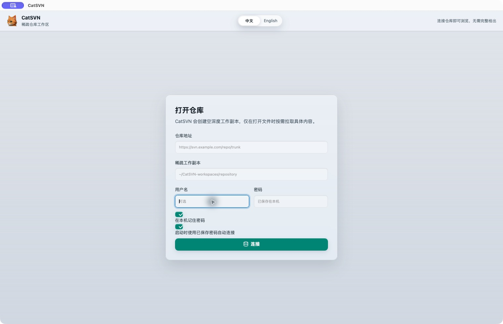

<p align="center">
  
</p>

<h1 align="center">CatSVN</h1>

<p align="center">
  A desktop Subversion client that only downloads the files you actually open.
  <br />
  <sub>English | <a href="README.zh-CN.md">中文</a></sub>
</p>

<p align="center">
  <a href="LICENSE"></a>
  
  
</p>



## Why

Subversion clients normally want the whole tree. On a repository with tens of
thousands of files, that means a long first checkout and hundreds of megabytes
of disk for documents you may never open. The paid macOS clients are polished
but pricey, and the open ones tend to either be ancient or still assume a full
working copy.

CatSVN flips that around. Connecting creates an **empty-depth** working copy, and
content is pulled one file at a time as you browse. You can still check out a
folder properly when you want to work in it, and drop it again to reclaim the
space.

## Features

**Browsing**

- Save several repositories and switch between them with one click
- Lazy remote browsing straight from `svn list` — no checkout needed to look around
- Filter the current folder, and move through rows with the arrow keys
- Back and forward through visited folders with the toolbar, the mouse side
  buttons, or `⌘[` / `⌘]`
- Repository, folder, and file history, with a diff of any revision against HEAD

**Sparse working copies**

- Preview a single file streamed from the repository (`svn cat`) without
  writing it to disk
- Edit a file by fetching only that file (`svn update --parents`)
- Check out a folder at files-only, immediate-children, full, or custom depth
- Drop a checked-out folder again with `--set-depth exclude` to free the space,
  leaving the repository untouched
- Refresh a local folder with `svn update`, keeping its sparse depth as-is

**Editing and committing**

- Text editing with a unified diff before you commit
- Rendered previews for Markdown (GFM tables, code, links open in the browser),
  images, PDF pages, Word `.docx` files, and Excel/CSV sheets with tab switching
- Drag-and-drop uploads are previewed from the repository without ever being
  written to disk
- Update, revert, and commit the current file
- Upload files or folders into the current remote directory, then commit them
  in one atomic revision
- Drag and drop from Finder to stage files and whole folders
- Review and discard pending uploads and local uncommitted changes
- Binary files are fetched on demand and handed to the default app instead of
  failing inside the editor

**Interface**

- Bilingual UI (English / 简体中文) that follows the system language
- Native macOS window vibrancy, with frosty layered surfaces that follow the
  light and dark system appearance
- Resizable repository and changes panels

## Requirements

- macOS 10.15 or newer (Tauri's minimum; the app is developed and tested on
  recent releases — see [Known limitations](#known-limitations))
- A Subversion command line client, 1.8 or newer
- Node.js 20.19 or newer, or 22.12 and newer (Vite's requirement)
- Rust toolchain (for building from source)

```bash
brew install subversion node rust
```

CatSVN shells out to the `svn` binary instead of linking against Subversion
libraries. It looks for the client in `/opt/homebrew/bin`, `/usr/local/bin`,
`/opt/local/bin`, `/usr/bin`, and `/bin`, so a Homebrew install is found even
when the app is launched from Finder.

## Getting started

```bash
git clone https://github.com/iamtorson/CatSVN.git
cd CatSVN
npm install
npm run tauri dev     # run in development
npm run tauri build   # produce CatSVN.app and a .dmg under src-tauri/target/release/bundle
```

Useful checks:

```bash
npm run typecheck             # TypeScript
npm run build                 # front-end bundle
cd src-tauri && cargo test    # Rust unit tests
```

## Usage

1. **Connect.** Enter a repository URL. A working copy is created in
   `~/CatSVN-workspaces/<host>` unless you pick a different folder. The URL and
   folder are remembered, and with *Automatically connect on launch* enabled
   CatSVN reconnects on the next start.
2. **Look around.** The remote view lists folders on demand. Clicking a folder
   navigates; nothing is downloaded yet.
3. **Check out what you need.** Use the checkout button on a folder row and pick
   a depth:
   - *Files in this folder* — the folder and its immediate files
   - *Immediate folders and files* — one level of subfolders
   - *Full folder* — the entire subtree
   - *Custom depth* — a specific number of directory levels
4. **Switch views.** *Remote* shows everything in the repository; *Checked out*
   shows only what exists on disk, mirroring the real folder hierarchy.
5. **Edit.** Double-click a file to preview it. Editing fetches just that file.
   Review the diff, then commit with a message.
6. **Upload.** Use *Upload file* / *Upload folder*, or drag items from Finder
   into the window. Uploads are staged in the working copy; commit them when
   you are ready.
7. **Free the space.** *Remove local checkout* drops a folder from the working
   copy with `--set-depth exclude`. The repository is untouched, and uncommitted
   local edits in that folder are discarded, so commit first.

Right-click a folder row for a quick *Refresh folder* action (in the local view
this runs `svn update` for that folder).

## Credentials

- Credentials are handed to `svn` over stdin with
  `--password-from-stdin --no-auth-cache`, so a password never appears in the
  process arguments and is never written to Subversion's own credential cache.
- Every command runs with `--non-interactive`, so an authentication failure is
  reported in the UI instead of hanging on a terminal prompt.
- With *Remember password on this Mac* enabled, the account is stored in
  `~/Library/Application Support/CatSVN/credentials.json` with `0600`
  permissions. Uncheck the box, or delete that file, to forget it.
- The login keychain is deliberately not used: the bundle is ad-hoc signed, so
  its code signature changes on every rebuild and macOS would otherwise ask for
  your login password again after each build.

## Keyboard shortcuts

| Shortcut | Action |
| --- | --- |
| `↑` / `↓` / `Home` / `End` | Move through the folder list |
| `Enter` | Open the focused folder, or preview the focused file |
| `⌘[` / `⌘]` | Back / forward |
| Mouse back / forward buttons | Back / forward |
| Double-click a file | Preview |
| `Esc` | Close the current dialog or menu |
| `⌘C` / `⌘V` | Copy and paste inside text fields and the preview |

## How the sparse working copy works

Connecting runs the equivalent of:

```bash
svn checkout --depth empty <url> <workspace>
```

The workspace then holds only SVN metadata. Opening a file for editing runs:

```bash
svn update --parents <workspace>/<path/to/file>
```

Subversion creates the missing parent directory records and downloads exactly
that target. Commits name the selected file, so unrelated repository content is
never swept into a revision.

## Tech stack

- **Shell:** [Tauri 2](https://tauri.app) (Rust) with macOS window vibrancy
- **UI:** React 19 + TypeScript, bundled by Vite
- **Icons:** [lucide-react](https://lucide.dev)
- **SVN access:** the `svn` command line client, driven from Rust
- **Parsing:** `roxmltree` for `--xml` output, `encoding_rs` for decoding file contents

## Project layout

```
src/                     React front end
  App.tsx                main window: browser, file panel, changes panel, dialogs
  App.css                liquid-glass design system (light and dark tokens)
  i18n.ts                English and Chinese strings
src-tauri/               Rust side
  src/lib.rs             Tauri commands wrapping the svn client
  tauri.conf.json        window, vibrancy and bundle configuration
  icons/                 app icons
docs/                    screenshots used by this README
```

## Known limitations

- macOS is the primary target. The stack is cross-platform, but window vibrancy
  and the `macOSPrivateApi` flag are macOS specific, and Windows/Linux have not
  been tested.
- Working copy status is read with a single `svn status` over the whole working
  copy, which can be slow on very large checkouts.
- The diff view is unified text only; there is no side-by-side mode.
- Binary files can be fetched and opened in the default application, but not
  edited inside CatSVN.
- The app requires a working `svn` binary; it does not bundle one.

## Contributing

Issues and pull requests are welcome. Before opening a PR:

```bash
npm run typecheck
npm run build
cd src-tauri && cargo fmt --check && cargo clippy --all-targets && cargo test
```

Please keep changes focused, and describe the SVN command behaviour you are
relying on when you touch the Rust side.

## License

[MIT](LICENSE)
